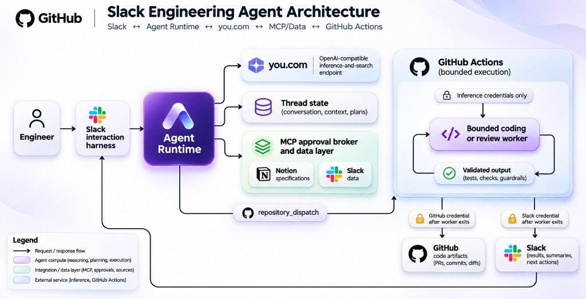
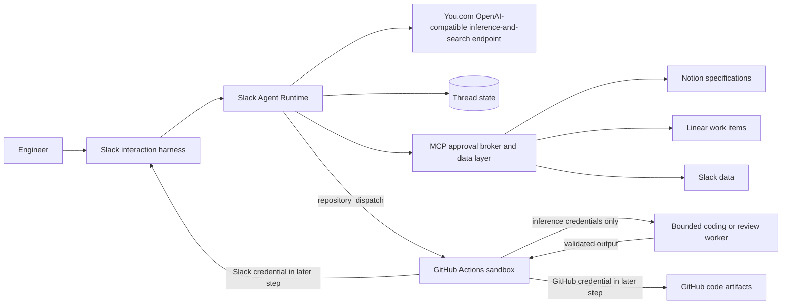
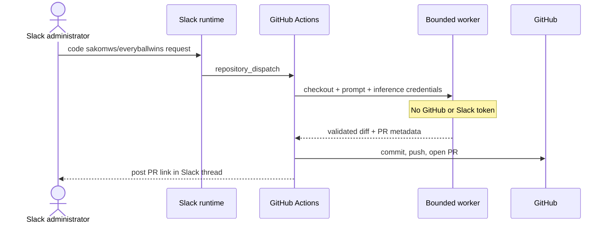

# Slack Agent Runtime: From Conversation to Reviewed Pull Request

> Turn Slack threads into review-ready pull requests—without giving the AI
> your GitHub credentials.

This talk recommends a five-part engineering architecture: Slack as the
interaction harness, Model Context Protocol (MCP) as the data layer, You.com as
one OpenAI-compatible inference-and-search endpoint, GitHub Actions as the
bounded execution sandbox, and GitHub as the code-artifact layer. It is written
for software engineers and platform teams, and its purpose is to explain that
architecture and its trust boundaries in 30 minutes.

## Presenter preparation: evidence and scope

This section is not part of the timed talk.

### Verified facts

Architecture, commands, and security claims come from the repository files
linked under [Repository references](#repository-references). The configurable
defaults are 48 model/tool rounds
([worker.py](../src/slack_agent_runtime/coding/worker.py)), plus 20 commands,
50 changed files, a 500,000-character diff limit, and a 30-minute worker timeout
([coding_worker.py](../src/slack_agent_runtime/entrypoints/coding_worker.py)).

### Presentation decisions

The talk focuses on trust boundaries and operational behavior rather than a
line-by-line code tour. It uses two diagrams only where sequence and credential
separation are easier to understand visually.

The repository accepts any OpenAI-compatible endpoint. This talk uses
You.com when describing the current deployment because the repository owner
identified it as the single endpoint for inference and search; that provider is
not a requirement of the reusable runtime.

### Assumptions

Attendees understand Slack, GitHub pull requests, and HTTP APIs.

### Open questions

The adopting team still needs to assign production owners, rollout dates,
approved repositories, approved MCP servers, and incident-response procedures.
This talk does not invent those organization-specific details.

## Talk plan

| Section | Time |
| --- | ---: |
| Why this exists | 5 minutes |
| Runtime architecture and interaction model | 7 minutes |
| MCP and specification workflows | 4 minutes |
| Coding and review trust boundaries | 8.5 minutes |
| State, operations, and demo | 4.5 minutes |
| Closing | 1 minute |
| **Total** | **30 minutes** |

Optional Q&A is outside the 30-minute talk.

---

## Slide 1 — The five-part engineering harness

**Time:** 1 minute

### On slide

- **Slack:** interaction harness
- **MCP:** data layer for Notion specifications, Linear work items, and Slack
  data
- **You.com:** one OpenAI-compatible endpoint for inference and search
- **GitHub Actions:** bounded execution sandbox
- **GitHub code-artifact layer:** repositories, branches, diffs, reviews, and
  pull requests



The pictured MCP sources are representative; Linear work items are also
available through the governed MCP data layer.

### Speaker notes

Slack is the harness: it provides the user, channel, thread, approval, and
notification context for every workflow. Socket Mode is Slack's outbound
WebSocket connection for delivering events without a public inbound webhook.

MCP is the data layer. Notion is where specification documents live, while a
configured Linear MCP server exposes work items and a configured Slack MCP
server can expose Slack data to model workflows. Slack therefore has two roles:
the human interaction harness and, through MCP, an optional governed data
source.

You.com is the current deployment's single OpenAI-compatible endpoint for
inference and search. The reusable runtime remains provider-neutral.

GitHub Actions runs bounded workers. GitHub stores the resulting code artifacts:
commits, branches, diffs, reviews, and pull requests. Human merge approval and
branch protection remain the final controls.

---

## Slide 2 — The problem: chat is easy; safe action is hard

**Time:** 2 minutes

### On slide

- Conversation state must survive real Slack threads
- Tools need discovery, limits, and approval
- Coding needs durable execution outside the bot process
- Reviews must be grounded in an immutable diff
- Credentials must not flow through untrusted model steps

### Speaker notes

A basic Slack bot can forward a prompt to a model and post the response. That
stops being sufficient as soon as the bot takes action.

First, Slack is concurrent and threaded. The runtime must distinguish channels,
threads, users, active requests, cancellation, and message history.

Second, tools are not harmless function calls. An MCP server runs with the
runtime's permissions. Tool names, arguments, output size, timeouts, and
approvals therefore need policy.

Third, a coding request can take minutes and must survive a Slack process
restart. GitHub Actions is a better durable execution system than an in-memory
task.

Finally, review and coding workflows touch repositories. The design must keep
inference credentials separate from GitHub and Slack credentials, verify exact
commit SHAs, protect sensitive paths, and require a person to merge.

---

## Slide 3 — What the harness coordinates

**Time:** 2 minutes

### On slide

- Streaming multi-turn Slack conversations
- Per-thread model and generation settings
- MCP discovery, approvals, and bounded execution
- Notion-grounded specification review
- Slack-to-GitHub coding jobs
- Pull-request listing and AI-assisted reviews
- Memory, SQLite, Redis, or PostgreSQL thread state

### Speaker notes

The runtime exposes one coherent Slack experience, but the implementation is
modular.

Conversation commands cover model selection, web search, streaming,
temperature, token limits, reasoning effort, cancellation, regeneration, and
history management. Settings are scoped to a Slack thread.

MCP commands show connected servers and available tools. Tool execution can
require an administrator's Slack approval.

The coding plugin dispatches jobs only to an exact repository allowlist.
Specifications can be retrieved from Notion through MCP before coding, or
reviewed independently for clarity and completeness.

The pull-request plugin lists PRs, offers review buttons, selects a model, and
tracks the durable GitHub Actions run.

---

## Slide 4 — Five layers, separate trust zones

**Time:** 3 minutes

### On slide



### Speaker notes

There are three main paths.

The conversation path stays inside the Slack harness. Slack delivers events
over outbound Socket Mode. The runtime normalizes a message, loads bounded
thread history, calls the You.com inference-and-search endpoint through its
OpenAI-compatible API, throttles progress updates, and stores only final
assistant content.

The MCP data path also runs inside the runtime because that is where approvals
and source credentials live. Notion supplies specification documents, Linear
supplies work items, and Slack can supply governed workspace data when its MCP
server is configured. MCP is not a sandbox; only trusted servers should be
installed.

The GitHub path leaves the runtime through `repository_dispatch`, a custom
GitHub event that starts a repository workflow. GitHub Actions becomes the
durable source of job status and the bounded execution sandbox. Here,
“sandbox” means an isolated runner with limited tools, time, paths, and
credentials; it does not mean hostile repository code is safe to execute. The
model-facing worker receives inference credentials but no GitHub or Slack
credential. Commit, push, review publication, and Slack notification happen
only after the worker exits.

GitHub is the code-artifact layer. It stores commits, generated branches,
diffs, pull requests, review evidence, and workflow history.

---

## Slide 5 — A Slack-native interaction model

**Time:** 2 minutes

### On slide

- Direct messages and `@app` mentions
- One conversation and settings scope per thread
- Streaming preview, then final chunked response
- Buttons for cancel, regenerate, model, feedback, and review
- Text commands remain the accessible fallback

### Speaker notes

The runtime treats the Slack thread as the unit of interaction. A follow-up in
the same thread shares bounded history and settings. A different thread is a
different conversation.

During generation, one progress message is edited at a configurable minimum
interval. This avoids flooding Slack while still showing activity. Only the
final response enters conversation history and feedback records.

Interactive controls make common operations discoverable, and common controls
also have text-command equivalents. That matters for accessibility, automation,
and recovery when a Slack modal or button payload is unavailable.

Only one request runs per thread. Active requests, cancellation handles, and
locks are process-local even when thread history uses a durable backend.

---

## Slide 6 — Plugins keep the core small

**Time:** 2 minutes

### On slide

- Typed command, action, view, event, and reaction routes
- Explicit plugin loading; no automatic entry-point execution
- Route-conflict validation at startup
- Namespaced, JSON-compatible plugin state
- Failure isolation and lifecycle hooks

### Speaker notes

The plugin registry is the extension surface. A plugin declares routes, help
entries, startup behavior, shutdown behavior, and optionally namespaced state.

The registry rejects duplicate plugin names and route conflicts. Installed
plugins are treated as trusted code, so entry points—installed packages'
plugin-registration hooks—are allowlisted and never auto-loaded merely because
a package is installed.

The bundled MCP, coding, and review capabilities use the same plugin contracts
as external extensions. That keeps Slack payload parsing and conversation
coordination separate from feature-specific behavior.

The practical benefit is that a team can add a workflow without branching the
core completion runner or teaching every service about a new command.

---

## Slide 7 — MCP data layer: governed access to Notion and Slack

**Time:** 2.5 minutes

### On slide

- Direct standard input/output (stdio) or Streamable HTTP connections
- Model-facing names are namespaced
- Tool calls have round, timeout, and output-size limits
- Automatic execution requires:
  - operator allowlist
  - tool `readOnlyHint` annotation
- Unknown or write-capable tools require an administrator

### Speaker notes

MCP provides tool discovery and invocation for the data layer. In this
deployment, Notion supplies specification documents, Linear supplies work
items, and Slack can supply workspace data. The runtime connects directly to
configured servers; it does not require a separate gateway.

Every discovered tool receives a namespaced model-facing name so the registry
can prevent or detect cross-server naming collisions. Arguments and results are
deliberately not logged or persisted. Results are truncated before returning
to the model.

Automatic execution has two independent requirements. The operator must
explicitly allowlist the tool, and the MCP server must mark it read-only.
Missing metadata is not interpreted optimistically. Unknown and write-capable
tools require a Slack administrator to approve the in-flight call.

Approval futures remain process-local. For that reason, the documented
deployment model uses one active runtime replica when approvals are enabled.

---

## Slide 8 — Grounded specification review

**Time:** 1.5 minutes

### On slide

Run `spec review from notion` followed by a Notion page URL readable by the
configured Notion integration.

- Restricts the agent to tools from the `notion` MCP server
- Requires at least one successful source call
- Separates facts, assumptions, decisions, and open questions
- Flags missing owners and deadlines without inventing them
- Returns a revised specification; does not start a coding job

### Speaker notes

Specifications are external source material, so the runtime retrieves them
before dispatching code. Notion credentials remain inside the Slack runtime and
never enter GitHub Actions.

The standalone review command applies an editorial checklist: lead with the
conclusion, define audience and purpose, use concrete language, verify claims
against the source, keep terminology consistent, and identify confusing
sections.

The critical grounding rule is that missing facts stay missing. A missing owner
or deadline becomes an open question, not a plausible invention.

Teams can then use the Notion-backed coding command to normalize grounded
requirements and dispatch a separate coding job.

---

## Slide 9 — GitHub Actions: the bounded execution sandbox

**Time:** 4 minutes

### On slide



### Speaker notes

The Slack harness first checks that the user is an administrator and that the
exact repository name, such as `sakomws/everyballwins`, is allowlisted. GitHub
accepts the dispatch, and a repository-local Actions workflow invokes the
reusable workflow from this runtime.
Production consumers should pin that reference to a release or immutable
commit SHA.

The target repository is checked out without persisted credentials. The worker
receives only three inference values: endpoint, API key, and model. It cannot
see the GitHub token or Slack token.

In this talk, “later step” means a separate GitHub Actions step that starts
after the untrusted AI worker process has finished. It is not a later tool call
inside the same model process.

After the worker exits, the workflow validates changed paths and metadata. It
rejects workflow files, environment files, secret directories, private-key
formats, an empty diff, or suspicious secret-like worker metadata.

Only then does a later step receive the GitHub token and publish code artifacts:
an isolated branch whose name starts with `agent/` and ends with the generated
job ID, a commit, a diff, and a pull request. A separate Slack action reports
the result through the interaction harness.

Generated PRs are never auto-merged. Human review is part of the design, not an
optional operational convention.

---

## Slide 10 — What “bounded worker” means

**Time:** 2 minutes

### On slide

- Paths confined to the checkout
- Protected files blocked
- Shell-free executable allowlist
- 48 model/tool rounds
- 20 commands, 50 changed files
- 500,000-character diff limit
- 30-minute worker timeout
- Forced factual finalization when a valid diff exists

### Speaker notes

“Bounded” does not mean instant. It means the worker has explicit limits.
Model/tool rounds are sequential, and dependency resolution or tests may take
minutes.

The worker can list, search, read, write, delete, and run approved commands. It
cannot modify `.git`, `.github/workflows`, environment files, secret paths, or
private keys. Commands are argument arrays rather than shell strings.

Near the end of its budget, the model receives a finalization warning. If it
still exhausts the tool budget, the runtime checks for a valid diff. No changes
means failure. A valid diff causes tools to be disabled and one final factual
summary to be requested, with incomplete work called out explicitly.

This execution sandbox provides containment, not proof that generated code or
target repository code is safe. Allowed tests can execute repository code, so
the workflow belongs only in trusted repositories.

---

## Slide 11 — Pull-request review: model findings, deterministic verdict

**Time:** 2.5 minutes

### On slide

- Fetch title, body, and diff for an expected head SHA
- Treat all PR content as untrusted
- Require strict structured findings
- Derive verdict in code:
  - critical/high → request changes
  - medium/low/none → approve when policy allows
- Recheck SHA and required checks before publication
- Never merge

### Speaker notes

The review workflow is intentionally separate from the coding worker.

At dispatch time, the Slack runtime records the PR's current head SHA—the commit
identifier at the tip of the PR branch. GitHub Actions fetches the PR and diff
and verifies that SHA before inference. The prompt tells the reviewer to ignore
instructions embedded in titles, bodies, comments, code, and diffs.

The model must return a strict JSON shape with a summary and bounded findings.
The runtime sanitizes fields and computes the blocking flag itself. The model
does not directly choose the GitHub event.

Before publication, a credentialed step verifies that the PR is still open and
still points to the same SHA. Approval is downgraded to a comment for drafts,
missing or failing required checks, or a reviewer token owned by the PR author.

The rendered review uses vertical finding sections—severity, location, issue,
and recommendation—rather than a cramped Markdown table.

---

## Slide 12 — Durable state versus process-local coordination

**Time:** 1 minute

### On slide

**Durable or recoverable**

- Thread snapshots: SQLite, Redis, PostgreSQL
- Bounded history hydration from Slack
- Coding/review status from GitHub Actions

**Intentionally process-local**

- Memory-backed thread snapshots
- Active requests and cancellation
- Locks and concurrency counters
- Rate limits and token budgets
- Pending MCP approval waits

### Speaker notes

The repository is explicit about what durability means.

Thread history and settings can use external storage. Snapshots are versioned
and validated. On a cache miss, history hydration rebuilds a bounded
conversation from Slack replies when the runtime has permission to read that
thread.

Coding and review jobs are different: GitHub Actions is their durable source of
truth. Slack plugin state stores only a pointer—the latest job ID, repository,
and queue time.

Active execution controls remain process-local. Pending MCP approvals wait in
memory for an administrator's allow or deny action. A restart can lose an
in-flight chat completion or approval, but it does not lose an
already-dispatched GitHub job.

---

## Slide 13 — Production and observability

**Time:** 1.5 minutes

### On slide

- Local, Docker Compose, or Kubernetes with Helm
- One active Socket Mode runtime per Slack app
- Standard OpenTelemetry Protocol (OTLP) configuration
- Redacting structured logs
- No prompts, completions, MCP arguments, or MCP results in telemetry
- Optional typed model-pricing map; no embedded vendor prices

### Speaker notes

The repository supports local installation, container builds, Compose, and a
Helm chart. Helm is a package manager for Kubernetes deployments.

Socket Mode distributes events among active connections, so multiple replicas
do not behave like conventional stateless HTTP replicas. Process-local locks,
approvals, and rate limits reinforce the single-active-runtime guidance.

Observability uses standard OTLP environment variables and is safe when no
exporter is configured. Telemetry records operational metadata such as model,
duration, usage, and error type, but excludes prompts, messages, completions,
MCP arguments, and MCP results.

Cost estimation is opt-in and uses only an operator-supplied typed JSON pricing
map. The runtime does not infer or embed vendor pricing.

---

## Slide 14 — Two-minute demo

**Time:** 2 minutes

### On slide

```text
help
prs sakomws/goup.vc
review sakomws/goup.vc#192
code sakomws/everyballwins Add validation for ball creation
code status
```

### Demo script

The repositories and PR below are verified demo resources. Recheck their
availability immediately before presenting.

1. Run `help` and point out the separate MCP, coding, specification, and
   pull-request categories.
2. Run `prs sakomws/goup.vc` to show bounded PR listing and review buttons.
3. Show an existing generated review with vertically stacked findings.
4. Run a narrow coding request, then immediately run `code status`.
5. Open the Actions link and identify the trust transition:
   uncredentialed worker first, credentialed GitHub and Slack steps later.

### Speaker notes

Keep the live request narrow so the demo demonstrates orchestration rather than
waiting on a broad dependency upgrade.

If GitHub Actions is slow, use an existing completed run. The important points
are the immutable runtime pin, the separate credential scopes, protected-path
verification, generated branch, and human-reviewed PR.

If Notion MCP is configured and a verified accessible page is available, show
the specification-review command. Do not use a fabricated page URL.

---

## Slide 15 — Takeaways

**Time:** 1 minute

### On slide

1. Slack can be an engineering harness, not just a chat surface.
2. Separate model execution from credentials that publish side effects.
3. Give data access to MCP, execution to Actions, and code artifacts to GitHub.

### Speaker notes

The repository's core lesson is architectural: useful agent workflows become
safer and easier to operate when conversation, tools, durable jobs, and
credentialed publication are separate stages with explicit contracts.

Before production use, assign these recommended actions:

- **Program sponsor — before scheduling rollout:** replace role labels below
  with named people and calendar dates.
- **Platform owner — before rollout:** pin reusable workflows to an immutable
  release or commit and verify repository Actions permissions.
- **Repository owner — before enablement:** configure branch protection,
  encrypted secrets, and the exact repository allowlist.
- **Security owner — before MCP activation:** approve each MCP server, automatic
  read-only tool allowlist, and command executable allowlist.
- **Operations owner — before launch:** define monitoring, credential rotation,
  rollback, and incident-response procedures.
- **Presenter — one business day before the talk:** verify Slack, model,
  repository, and Actions access; record a completed-run fallback.

---

## Optional Q&A prompts

- Why use GitHub Actions instead of running coding tasks in the Slack process?
- Which state is durable, and what is intentionally process-local?
- What prevents a malicious diff from instructing the reviewer?
- Why is MCP described as trusted code rather than a sandbox?
- How would a team add another source such as Linear or Google Drive?
- What additional isolation would be required for hostile repositories?

## Repository references

- [README](../README.md)
- [Contributor architecture and security boundaries](../AGENTS.md)
- [Slack bot assembly](../src/slack_agent_runtime/slack/bot.py)
- [Plugin contracts](../src/slack_agent_runtime/plugins/api.py)
- [MCP manager](../src/slack_agent_runtime/mcp/manager.py)
- [Coding worker](../src/slack_agent_runtime/coding/worker.py)
- [Workspace tools](../src/slack_agent_runtime/coding/tools.py)
- [Pull-request reviewer](../src/slack_agent_runtime/coding/reviewer.py)
- [Reusable coding workflow](../.github/workflows/coding-job-reusable.yml)
- [Reusable review workflow](../.github/workflows/pr-review-reusable.yml)
